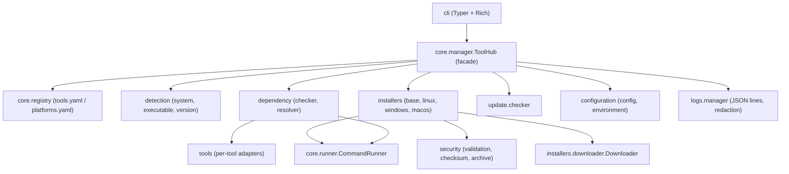

# eSim ToolHub — Architecture

> eSim ToolHub is an independent screening-task prototype intended for potential
> integration with [eSim](https://github.com/FOSSEE/eSim). It is **not** the official
> eSim tool manager.

## Layering

Rules that keep the core stable:

1. **Data, not code, describes tools.** Every tool lives in
   `src/esim_toolhub/resources/tools.yaml`. Adding a tool needs no Python changes
   unless it has a genuine quirk (e.g. KiCad 6 has no `kicad-cli`), in which case a
   small adapter in `tools/` overrides one hook.
2. **Side effects sit behind injectable interfaces.** `CommandRunner`, `Downloader`,
   `ExecutableLocator`, `EnvironmentManager` and the admin check are constructor
   arguments. Tests replace all of them; no test installs software or touches the network.
3. **Platform differences live in installer adapters.** `LinuxInstaller`,
   `WindowsInstaller` and `MacOSInstaller` decide which install methods are legal,
   how privilege escalation works, and how packages are upgraded. The core manager is
   platform-agnostic.
4. **Plans before actions.** Every install/update/uninstall produces an
   `InstallPlan` first. `--dry-run` renders the plan and stops; real execution runs
   exactly the commands in the plan.

## Deviations from the suggested layout

| Suggested | Actual | Reason |
|---|---|---|
| `resources/` at repo root | `src/esim_toolhub/resources/` | Ships inside the wheel so non-editable installs work. |
| `logging/` package | `logs/` package | Avoids shadowing the stdlib `logging` module. |
| — | `core/runner.py` | Single choke point for subprocess execution (no `shell=True`). |
| — | `installers/package_managers.py`, `installers/downloader.py`, `installers/factory.py` | Separates package-manager command construction, secure download, and OS-based installer selection. |
| — | `security/archive.py` | Safe zip/tar extraction (traversal, link and size checks). |

## Status model

`MISSING · INSTALLED · OUTDATED · INCOMPATIBLE · BROKEN · UNKNOWN` — see
[docs/design.md](docs/design.md) for the evaluation rules.
