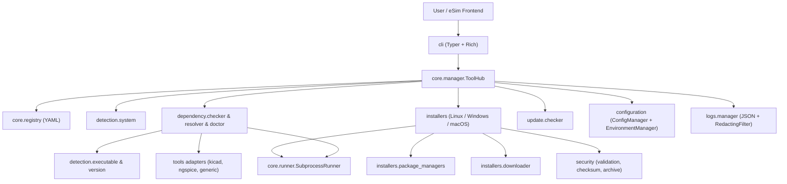
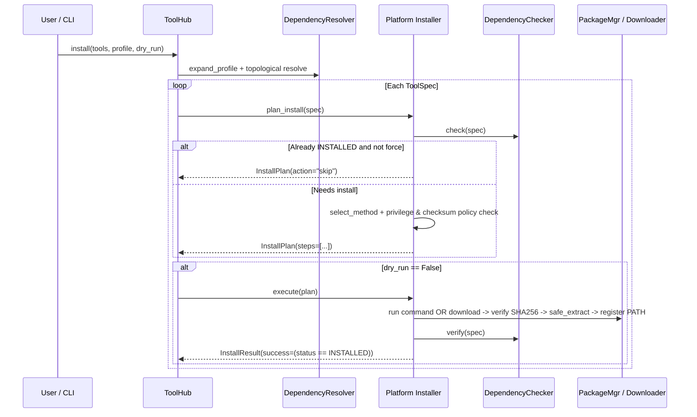
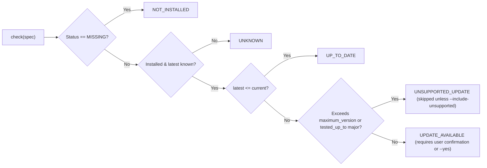

# eSim ToolHub — System Design Document

> Independent prototype developed for the FOSSEE / IIT Bombay eSim internship screening task.
> Not an official FOSSEE product.

## 1. Problem Statement

[eSim](https://github.com/FOSSEE/eSim) orchestrates multiple independent open-source EDA
engines: **KiCad** (schematic capture and PCB layout), **Ngspice** (analog/mixed-signal
simulation), **GHDL** (VHDL via NGHDL), **Verilator** (Verilog/SystemVerilog via NgVeri),
and **OpenModelica** (Ngspice-to-Modelica). Today, users face recurring setup problems:

- Package availability and versions differ drastically across Ubuntu LTS, Fedora, Arch,
  Windows (`winget`, Chocolatey, MSYS2), and macOS.
- Version incompatibilities break eSim workflows silently (for example, Ubuntu 22.04 ships
  KiCad 6 and Verilator 4, whereas current eSim targets KiCad >= 7 and Verilator >= 5;
  NGHDL requires GHDL's `llvm` or `gcc` backend rather than `mcode`).
- Non-interactive probing of GUI executables (`kicad.exe` on KiCad 6, `ngspice.exe` on
  Windows) can launch windows or hang.
- Diagnosing broken PATH entries, missing C/C++ host prerequisites, or outdated toolchains
  requires manual troubleshooting.

## 2. Goals & Non-Goals

### Goals
- Provide a clean, modular Python core and CLI tailored specifically to eSim's external
  tool ecosystem and workflow profiles (`minimal`, `analog`, `digital`, `full`).
- Detect host OS, distribution, WSL, architecture, Python, PATH health, and installed tools
  without modifying the host.
- Plan and execute safe installations and upgrades on Linux and Windows (with an
  extensible macOS adapter) and **always verify** installations afterward.
- Expose machine-readable JSON output (`--json`) and an injectable Python API so eSim's
  desktop GUI or installer scripts can consume ToolHub later.

### Non-Goals
- Not a generic system package manager or replacement for `apt`, `winget`, or `brew`.
- Does not modify upstream `FOSSEE/eSim` files, add third-party apt PPAs automatically,
  compile NGHDL/Ngspice from source, or silently edit user shell rc / Windows registry keys.

## 3. Requirements Mapping

| Requirement | Implementation |
|---|---|
| Tool installation & adapters | `installers/{base,linux,windows,macos,package_managers,downloader,factory}.py` |
| Declarative tool registry | `resources/{tools,platforms}.yaml`, `core/registry.py` |
| System & tool detection | `detection/{system,executable,version}.py`, `tools/{base,kicad,ngspice}.py` |
| Dependency & health engine | `dependency/{checker,resolver,doctor}.py`, `core/models.py` |
| Configuration & environment | `configuration/{manager,environment}.py`, `paths.py` |
| Safe update checking | `update/checker.py` |
| Security & validation | `security/{validation,checksum,archive}.py`, `core/runner.py` |
| Structured logging | `logs/manager.py` |
| CLI & JSON interface | `cli/{commands,formatter}.py`, `main.py` |

## 4. Architecture & Component Responsibilities

- **`core.manager.ToolHub`**: Thin orchestration facade; holds session report cache and wires
  injectable dependencies.
- **`core.registry.Registry`**: Parses and validates `tools.yaml` and `platforms.yaml` at
  load time (package IDs, URLs, SHA256 formats, regex groups, cross-references).
- **`detection`**: Pure system inspection, natural-sorted executable search (`PATH` ->
  managed -> registry search globs), and numeric `Version` parsing (`ngspice-44`, `5.028`,
  `v9.0.1`).
- **`dependency`**: Evaluates every tool into one of `MISSING`, `INSTALLED`, `OUTDATED`,
  `INCOMPATIBLE`, `BROKEN`, `UNKNOWN`; resolves profile inheritance and topological tool
  order; produces `DoctorReport` audits.
- **`installers`**: Plan-first execution. Every install, update, or uninstall produces an
  `InstallPlan` before any side effect occurs.

## 5. Key Flows

### 5.1 Installation & Verification Flow

### 5.2 Dependency Resolution & Status Evaluation

1. `DependencyResolver.expand_profile` resolves `extends` depth-first, detecting cycles.
2. `DependencyResolver.resolve` orders transitive `depends_on` edges (e.g. `ghdl` ->
   `ngspice` first), raising `DependencyCycleError` on cycles.
3. `DependencyChecker.check` verifies platform & architecture support -> locates binary ->
   checks `adapter.can_probe` -> runs version command with timeout -> parses numeric version ->
   checks variant rules (e.g. GHDL `mcode` warning) -> compares against `minimum_version`,
   `tested_up_to`, and `maximum_version` -> inspects host prerequisites (`gcc`, `g++`, `make`).

### 5.3 Update Flow

### 5.4 Configuration & Environment Flow

- `ConfigManager` reads/writes validated YAML atomically (`mkstemp` + `os.replace`) in the
  OS-native directory returned by `platformdirs` (overridable with `ESIM_TOOLHUB_HOME`).
- `EnvironmentManager` records archive-installed `bin/` paths in `environment.json` so
  ToolHub immediately discovers them, while `esim-toolhub config env` prints explicit
  PowerShell/bash commands rather than silently mutating user profiles.

## 6. Security Model & Error Handling

See [SECURITY.md](../SECURITY.md) for the complete control list.

All expected failures raise typed subclasses of `ToolHubError` (`UnknownToolError`,
`RegistryError`, `ConfigError`, `SecurityError`, `UnsupportedPlatformError`, etc.).
`main.py` catches `ToolHubError` and prints a concise actionable message with a non-zero
exit code; raw tracebacks are hidden unless `--debug` is passed.

## 7. Testing Strategy

- All external side effects sit behind injectable interfaces (`CommandRunner`, `Downloader`,
  `ExecutableLocator`, `EnvironmentManager`, `AppPaths`, `has_sudo`).
- The pytest suite covers OS/arch detection, version parsing, registry validation, cycle
  detection, compatibility/doctor checks, security defenses (zip slip, tar symlink escape,
  SHA256 mismatch, untrusted hosts, shell-string rejection, log redaction), installer
  adapters, updates, config, and end-to-end CLI invocation with zero real installs.

## 8. Extensibility & Future eSim Integration

- **Adding a tool**: Edit `src/esim_toolhub/resources/tools.yaml` only; add a `tools/*.py`
  adapter only when the tool has non-standard CLI behavior.
- **Adding a platform**: Subclass `Installer` and wire it in `installers/factory.py`.
- **Integrating with eSim**:
  1. eSim's startup or Settings dialog can invoke `esim-toolhub status --json` or import
     `ToolHub` directly in Python to inspect detected binaries and pre-populate tool paths.
  2. eSim's setup wizard can call `esim-toolhub doctor --json` for pre-flight diagnostics
     and `esim-toolhub install --profile analog --dry-run` to preview changes before
     requesting user confirmation.
